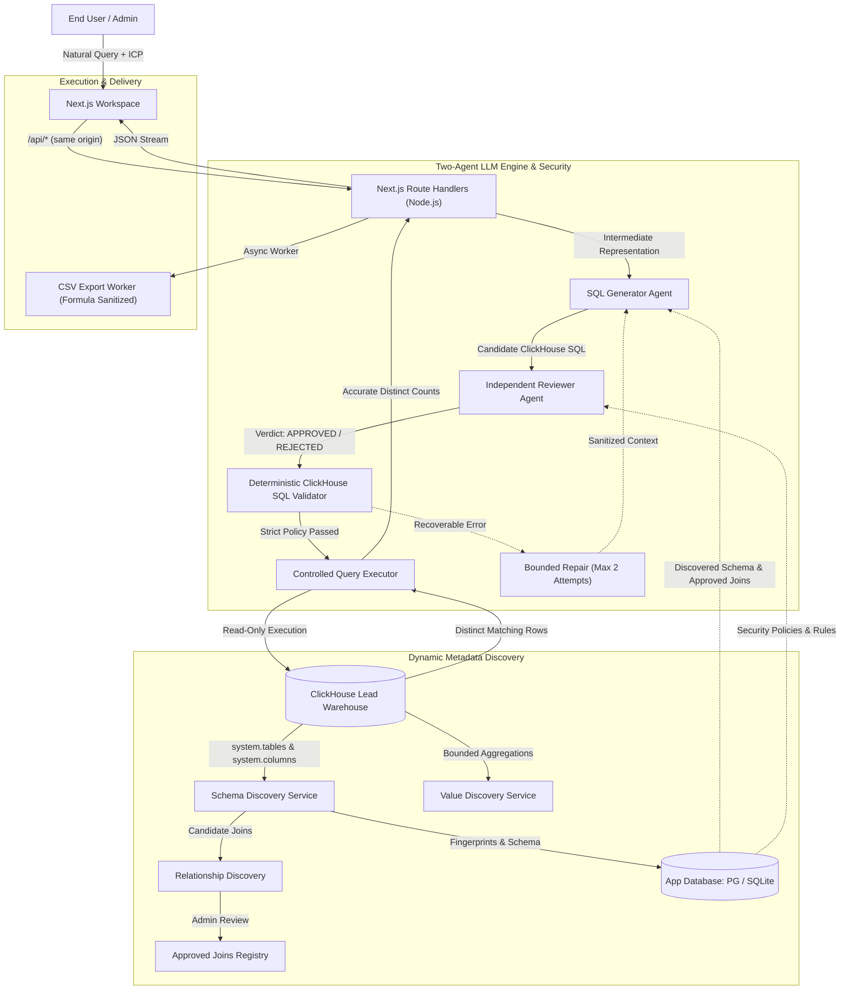

# Architecture Overview

The **LeadGen AI Platform** is an enterprise-grade autonomous B2B lead generation engine built on top of **ClickHouse** and **PostgreSQL** (or SQLite for standalone local testing). It allows internal teams and external customers to discover companies and contacts using natural language and structured Ideal Customer Profile (ICP) filters without hardcoded schema dependencies.

## Core Architectural Principles

### 1. Zero Hardcoded Schema Assumptions
The system does not assume tables are named `companies` or `contacts`, nor does it assume specific column types. At startup and on-demand via the admin console, the **Schema Discovery Service** queries ClickHouse system catalogs (`system.tables`, `system.columns`) strictly scoped to the configured database. It calculates a SHA-256 schema fingerprint to detect drift.

### 2. Two Distinct LLM Agents with Separate Responsibilities
- **Agent 1: SQL Generator**: Translates natural language requests and structured ICPs into an intermediate search representation and generates syntactically valid ClickHouse SQL and exact count queries.
- **Agent 2: Independent SQL Reviewer**: Uses an independent system prompt and isolated evaluation logic to critically inspect the generated SQL against the discovered schema, approved joins, user role permissions, and read-only criteria.

### 3. Deterministic Application-Level Security
LLM output is treated as untrusted user input. Before execution, every query is tokenized and structurally analyzed by a ClickHouse-aware SQL analyzer (`src/server/services/clickhouseSql.ts`) that fails closed on anything it cannot parse, enforcing:
- Strictly read-only statements (`SELECT`, `WITH ... SELECT`, `UNION`).
- Total rejection of DDL (`DROP`, `ALTER`, `CREATE`) and DML (`INSERT`, `UPDATE`, `DELETE`).
- Rejection of multi-statement payloads.
- Strict table allowlists (no system tables or unapproved tables).
- Approved join verification (both tables and join keys must be in the approved relationships registry).
- Column-level sensitivity enforcement (e.g. `RESTRICTED` columns require `ADMIN` role).
- Dangerous function banning (e.g. `file`, `url`, `remote`, `mysql`, `sleep`).

### 4. Bounded Repair Loop
If a recoverable SQL execution error occurs, the sanitized error is returned to the generator. The platform permits **at most two repair attempts**, re-running both Agent 2 and the deterministic validator after every repair. Security violations, unapproved joins, and ambiguous queries trigger immediate failure or clarification prompts without retry loops.

### 5. Multi-Tenant Organization Isolation
Underlying lead records in ClickHouse are shared across organizations, but application-level state (saved searches, organization configuration, export jobs, users, and audit logs) is strictly isolated by `org_id` on the server.
